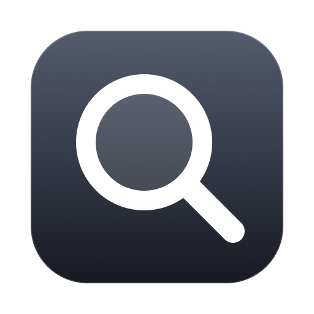

# Applight

A Spotlight-style launcher for macOS that searches only your installed apps. Nothing else.

- Native Swift and AppKit, no dependencies
- Instant: apps are held in memory, a search takes about 0.1 ms
- Fuzzy matching (`vsc` finds Visual Studio Code) that learns what you pick
- Lives in the menu bar, starts at login

## Install

Requires macOS 26 or later and Xcode.

```bash
./Scripts/build.sh install
```

Then free up Cmd+Space in System Settings → Keyboard → Keyboard Shortcuts → Spotlight, and relaunch Applight.

## Keys

| Key | Action |
| --- | --- |
| Cmd+Space | Show or hide |
| ↑ ↓ | Move selection |
| Return | Open app |
| Cmd+Return | Reveal in Finder |
| Esc | Dismiss |
